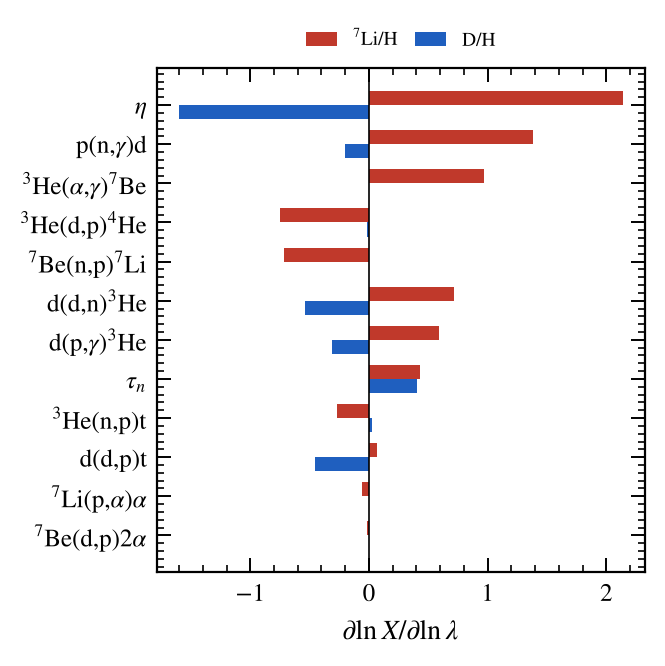
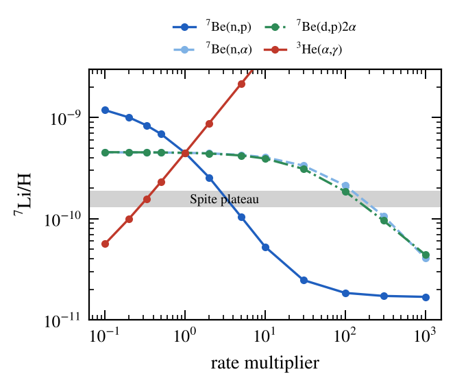
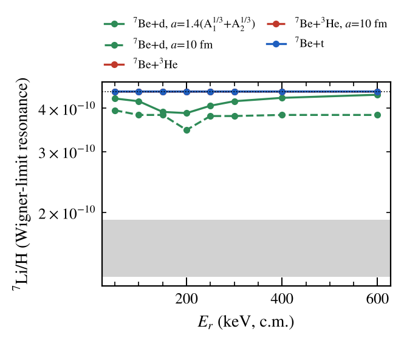
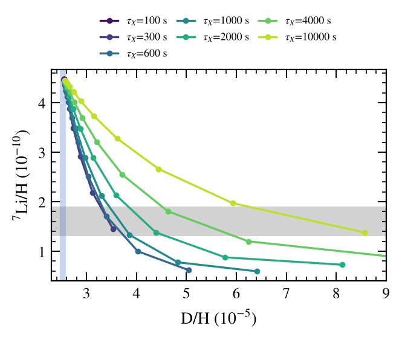

# Can nuclear physics solve the cosmological lithium problem?

Short answer: **no.** Every nuclear change that brings primordial ⁷Li/H down to
the Spite plateau is either excluded by measured cross sections, excluded by
the physics of Coulomb penetrability, or breaks D/H. The numbers below come from
a BBN code written for this study on pynucastro/REACLIB rates.

## The code (`bbn.py`)

- Standard cosmology: photons, e± with full Fermi–Dirac thermodynamics,
  decoupled neutrinos (N_eff = 3.044), entropy conservation through e±
  annihilation.
- n ↔ p: six weak processes in the Born approximation with Fermi–Dirac blocking
  at T_γ and T_ν, normalised to τ_n = 878.4 s (no radiative or finite-mass
  corrections, which is why Y_p is about 0.005 low).
- Network: every REACLIB rate (with detailed-balance inverses) linking n, p, d,
  t, ³He, ⁴He, ⁶Li, ⁷Li, ⁷Be, ⁸Li, ⁸B, ⁹Be, plus ⁷Be(d,p)2α (CF88, missing
  from REACLIB). The 3- and 4-body inverse fits are dropped. They are
  negligible and make the system ill-conditioned.
- Any rate can be scaled (`mult`), replaced (`replace`) or added (`extra`), and
  a late neutron source from a decaying particle can be switched on
  (`inject=(Y_n, τ_X)`). One run takes about 5 s.

### Validation (η₁₀ = 6.104, Planck)

| | this code | literature (PRIMAT / Fields et al. 2020) | observed |
|---|---|---|---|
| Y_p | 0.2421 | 0.2470 | 0.245 ± 0.003 |
| D/H (10⁻⁵) | 2.550 | 2.44–2.51 | 2.527 ± 0.030 (Cooke 2018) |
| ³He/H (10⁻⁵) | 1.05 | 1.04 | — |
| ⁷Li/H (10⁻¹⁰) | **4.48** | 4.7–5.6 | **1.6 ± 0.3** (Spite plateau, Sbordone 2010) |

The logarithmic sensitivities (`sensitivity.py`) reproduce the published ones,
e.g. Cyburt et al. 2016 for ⁷Li: η 2.14 (2.1), p(n,γ) 1.38 (1.33),
³He(α,γ) 0.97 (0.96), ³He(d,p) −0.75 (−0.75), ⁷Be(n,p) −0.72 (−0.71),
d(d,n) 0.71 (0.70), d(p,γ) 0.59 (0.59), τ_n 0.43 (0.43).



## What it takes to reach ⁷Li/H = 1.6 × 10⁻¹⁰

### A. Rescale a known rate (`lithium_fix.py`, part A)

| Channel | factor needed | measured to | verdict |
|---|---|---|---|
| ³He(α,γ)⁷Be | × 0.33 | ±3–4 % (LUNA, Solar Fusion III); also fixes the solar ⁷Be/⁸B ν fluxes | excluded |
| ⁷Be(n,p)⁷Li | × 3.2 | n_TOF 2018: +40 % at low E → −10 % on Li | excluded |
| ⁷Be(n,α)⁴He | × ~160 | n_TOF, Hou 2015, Lamia 2017–19 | excluded |
| ⁷Be(d,p)2α | × ~130 | Angulo 2005, Rijal 2019, HIE-ISOLDE 2022 | excluded |
| ⁷Li(p,α)α | none works | at Planck η 93 % of ⁷Li is made as ⁷Be | irrelevant |

None of these moves D/H, so D/H cannot rescue or rule out the scenario; the
cross-section data do.



### B. A missing resonance in ⁷Be + x (`lithium_fix.py` part B, `scans2.py`)

Single-level Breit–Wigner, s-wave, entrance width
Γ_in(E) = 2 P₀(E) θ² γ_W² with the Coulomb penetrability and the Wigner limit
γ_W² = 3ħ²/(2μa²), thermally averaged numerically. Even at θ² = 1 (the
largest physically allowed reduced width):

| partner | compound | best ⁷Li/H (10⁻¹⁰), a = 1.4(A₁^⅓+A₂^⅓) | a = 10 fm |
|---|---|---|---|
| d | ⁹B | 3.9 (E_r ≈ 200 keV) | 3.5 |
| t | ¹⁰B | 4.47 | 4.47 |
| ³He | ¹⁰C | 4.48 | 4.48 |

³He and t are too rare and too Coulomb-suppressed. The neutron channel is
already the dominant destruction path (case A).



**Cross-check against the Cyburt–Pospelov proposal** (`cp_check.py`): for a ⁹B
state at E_r = 170–220 keV with Γ_d = 40 keV, J = 5/2 and a = 10 fm:

| assumption for Γ_d(E) | ⁷Li/H (10⁻¹⁰) |
|---|---|
| scales with penetrability (physical) | 2.5–2.7 |
| held constant at all energies | 0.13 (overshoots by 10×) |

The full solution appears only when the entrance width is held constant down to
E → 0. Below the barrier that is unphysical: the cross section then grows as
1/k². With the penetrability-scaled width the best case is 2.5 × 10⁻¹⁰, about
3σ above the plateau, and it already needs a = 10 fm and the Wigner limit. The
⁹B level that was later measured (E_r = 310 keV, Γ = 81 keV) gives
4.3 × 10⁻¹⁰, a 5 % effect.

### C. Beyond the nuclear network: late neutron injection (`scans2.py`)

A particle decaying at τ_X = 10²–10⁴ s and releasing thermal neutrons destroys
⁷Be through ⁷Be(n,p)⁷Li(p,α), but the extra neutrons also make deuterium:

- Li/H reaches the plateau (1.70 × 10⁻¹⁰) only with D/H ≥ 3.40 × 10⁻⁵, 29σ
  above Cooke et al. 2018.
- With D/H within 2σ, Li drops by at most 5 %.

Hadronic showers would also make D, ³He and ⁶Li by ⁴He spallation, which is
ignored here. The bound above is therefore the most favourable case for the
solution.



## Conclusion

The ⁷Li discrepancy is a factor 2.8 at Planck η. Nuclear rates measured to
the percent level (³He(α,γ), the ⁷Be destruction channels) leave no room. A
missing resonance is capped by penetrability at ≤ 45 % even with extreme radii.
Neutron-injection physics trades the Li problem for a D problem. The remaining
explanations are stellar (depletion by atomic diffusion and turbulent mixing in
metal-poor dwarfs, supported by the Li "meltdown" below [Fe/H] ≈ −3) or new
physics that does not over-produce D. This matches the 2024 review conclusion
that the solution "may not reside in nuclear physics".

## Reproduce

```bash
pip install pynucastro scipy mpmath matplotlib
python3 bbn.py                 # baseline, about 5 s
python3 sensitivity.py         # about 1.5 min on 4 cores
python3 lithium_fix.py         # rate multipliers + resonance scan, about 15 min
python3 scans2.py              # Wigner-limit resonances, injection, η scan, about 15 min
python3 cp_check.py            # Cyburt–Pospelov cross-check, about 2 min
python3 figures.py             # PRC-style figures (uses ../../prc-figures)
```
