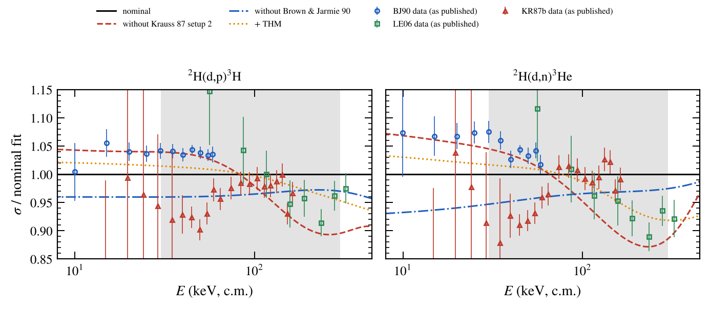
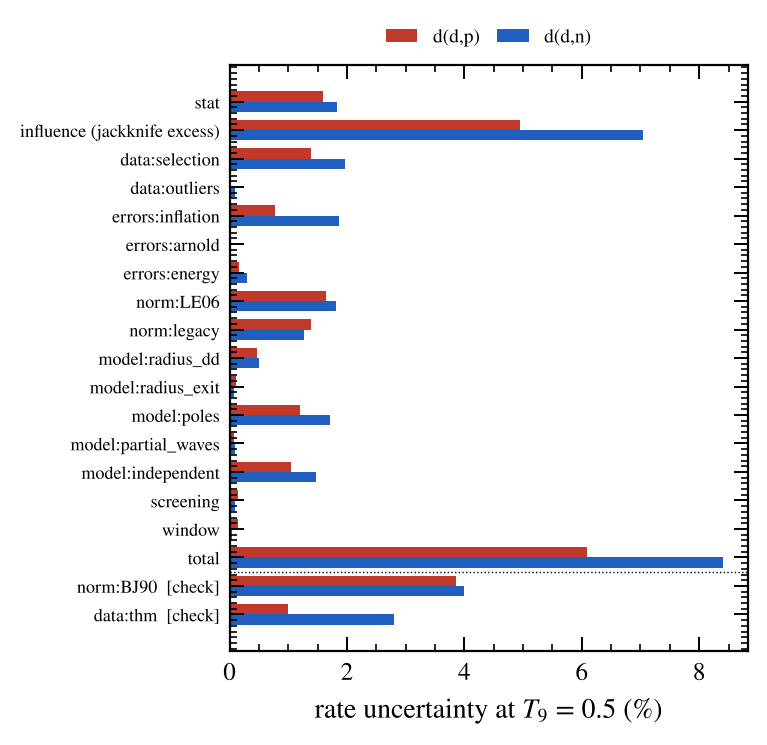
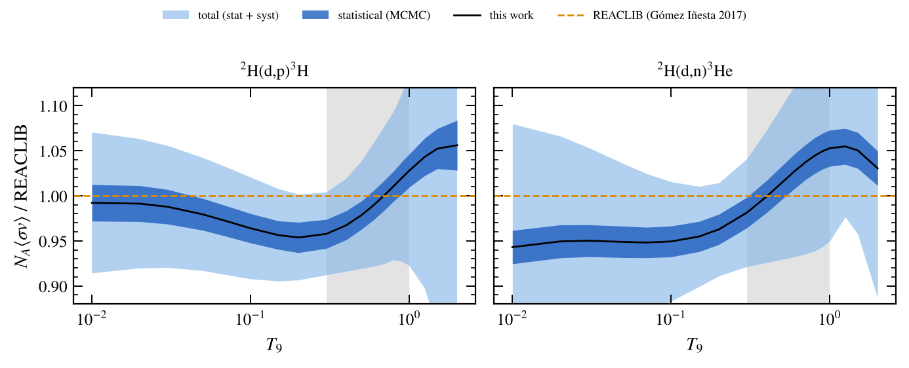

# ²H(d,p)³H and ²H(d,n)³He: R-matrix evaluation and systematic-uncertainty study

**Question.** How well do we actually know the two d+d rates that, after
d(p,γ)³He, control primordial deuterium? Recent BBN analyses quote about 1 %
for each. Is that supported once every analysis choice is varied?

**Answer.** Not at 1 %. The statistical uncertainty is about 1.8 % even after
inflating the data errors for their mutual inconsistency. The leading
uncertainty is not statistical and not the R-matrix model: it is a **scale and
shape tension between the precision datasets in the BBN window**. With all
choices varied, the rates are uncertain by **5–8 % (d,p) and 6–10 % (d,n)** at
T9 = 0.3–0.8, and BBN D/H by **−7 % / +8 %**. That is six times the
observational error on D/H (1.2 %). The nominal central values agree with
REACLIB's Bayesian rates (Gómez Iñesta et al. 2017) to within a few percent,
so the problem is the error bar, not the central value.

## The tension, in one figure



- Brown & Jarmie 1990 (BJ90, 10–58 keV, 1.3 % scale) and Leonard et al. 2006
  (LE06, 56–323 keV, scale about 2 %) are the precision anchors. Between them,
  only Krauss et al. 1987 setup 2 (KR87b, 15–162 keV) covers the BBN window
  continuously.
- Relative to the nominal curve, KR87b rises by about 9 % between 40 and
  150 keV, while BJ90 (below 58 keV) sits 4 % above it and LE06 (above 56 keV)
  5 % below it. The joint fit therefore rescales BJ90 and LE06 relative to each
  other by 10 % (fitted scales 1.041 and 0.948), against a combined quoted
  2.4 %: about a 4σ tension. Without KR87b, BJ90 and LE06 agree (relative
  scale 0.96).
- Dropping KR87b moves the rates by −3.7 % (d,p) and −6.1 % (d,n) at T9 = 0.5.
  The error model predicts 0.5–0.7 %, so the shift is z ≈ −8. The polynomial
  (model-independent) fits give −4.4 % and −8 %, so this is in the data, not in
  the R-matrix.
- In BBN, removing KR87b raises D/H from 2.544 to 2.687 × 10⁻⁵ (+5.6 %);
  removing BJ90 raises it to 2.633 × 10⁻⁵.

## Pipeline

| Step | File | What it does |
|---|---|---|
| data | `exfor_parse.py`, `build_data.py` | Parses the IAEA EXFOR mirror (GitHub; the EXFOR servers are not reachable from here). Curates 13 experiments with their quoted errors and a per-experiment systematic budget (scale error, energy calibration, shared d(d,p)/d(d,n) normalisations, the correlated Krauss setups). `data/catalog.json` |
| model | `make_azr.py` | Writes the ⁴He AZURE2 project: d+d (identical bosons, l+S even), p+t, n+³He; Jπ = 0⁺, 2⁺, 0⁻, 1⁻, 2⁻; one pole per Jπ at Ex = 30 MeV with free widths in all three channels (31 parameters with the normalisations) |
| likelihood | `fitter.py` | r_i = (n_k f_scr σ_R − σ_i)/s_i. One normalisation per measurement, shared by (d,p) and (d,n); Krauss setup 2 = setup 1 × an extra 5 %. Screening U_e = 20 eV on direct data. Energy-calibration errors folded in through dlnσ/dE. Gaussian norm priors. Analytic Jacobians from pyazr `model_gradients`. `PolyFit` = model-independent S(E) polynomial with the same likelihood |
| error model | `setup_nominal.py` | Per-experiment Birge factors and a PDG-style scale on the norm priors, iterated with the **model-independent** fit so data consistency is judged without the R-matrix |
| variations | `variations.py` → `run_fit.py` | 45 refits, one choice changed at a time |
| statistics | `mcmc.py`, `laplace.py` | emcee posterior (weak width prior at 20 Wigner units) → rate samples. Laplace (linearised) propagation as a check |
| budget | `analyze.py` | Rates, itemised budget, BBN propagation (`../bbn-lithium/bbn.py`). `results/dd_evaluation.json`, `results/dd_rates_table.txt` |
| figures | `figures_dd.py` | PRC-style figures in `figures/` |

AZURE2 itself was built from source with `-DBUILD_GUI=OFF`; all 13 of its
physics regression tests pass.

## Data and error model

| Exp. | Energy (keV, c.m.) | Scale prior | Birge factor | Fitted scale | Remark |
|---|---|---|---|---|---|
| BJ90 | 10–58 | 1.3 % | 1.81 | 1.041 | |
| KR87a / KR87b | 3–50 / 15–163 | 6.4 % / 8.1 % (correlated) | 1.59 / 2.07 | 0.934 / 0.969 | the EXFOR note that the dn errors include the 6.4 % scale is wrong (they are 1–2 %) |
| GR95 | 1.6–15 | free | 1.00 | 1.039 | normalised to Bosch & Hale by the authors |
| LE06 | 56–323 | 2 % (assumed) | 1.92 | 0.948 | scale not in EXFOR: varied 1–4 % |
| AR54 | 6.5–57 | 3 % | 2.56 | 0.989 | energy-dependent ±7 % drift |
| DA53, PR54, BO56, YI73, CH56, HO01 | various | 2–5 % (assumed where missing) | 1.0–1.7 | 0.75–1.03 | CH56: one 35 % outlier removed; YI73 has no errors in EXFOR |
| TU14 (THM) | 2.6–1480 | free | — | — | indirect; inclusion reported separately |

Without inflation the best possible fit (even a 6th-degree polynomial) has
χ² ≈ 600 for 223 points. The quoted errors of BJ90, KR87, LE06 and AR54 do not
describe their mutual scatter. The scale priors are inconsistent by a factor of
2.0 (χ²_prior = 42 for 11). The nominal R-matrix fit with the inflated errors
has χ² = 217 for 223 points.

## Uncertainty budget



| Source (rate %, T9 = 0.5) | d(d,p) | d(d,n) |
|---|---|---|
| statistical (MCMC, 32 000 steps; Laplace 1.9) | 1.6 | 1.8 |
| **dataset influence** (leave-one-out shifts beyond the error model; KR87b z = −8, BJ90 z = −2) | **5.0** | **7.0** |
| data selection (core experiments only) | 1.4 | 2.0 |
| Birge treatment (R-matrix-derived factors, none) | 0.8 | 1.9 |
| LE06 assumed scale (1–4 %) | 1.7 | 1.8 |
| legacy scales (5 → 10 %) | 1.4 | 1.3 |
| R-matrix pole placement (26/40 MeV, two poles, free energies) | 1.2 | 1.7 |
| model independence (polynomial S, deg 4–6) | 1.0 | 1.5 |
| channel radii (a_dd 4.5–8, a_pt 4–6 fm) | 0.5 | 0.5 |
| partial waves, screening (U_e 0–30 eV), energy calibration, fit window, outliers | ≤ 0.3 each | ≤ 0.3 each |
| **total** | **6.1** | **8.4** |
| *check:* BJ90 scale 3 % / free (counted in the influence term) | 2.6 / 3.9 | 2.7 / 4.0 |
| *check:* + THM data | −1.0 | −2.8 |

`norm:all` (every scale free) changes the rate by 59 %. That is not an
uncertainty: without any absolute scale the rate is undefined. It is a
diagnostic that the absolute normalisation comes entirely from the scale priors
of a few experiments.

## Rates and BBN



Tabulated in `results/dd_rates_table.txt`. Relative to REACLIB (`go17`/`gi17`):
d(d,p) is 0.96–1.03 and d(d,n) 0.95–1.05 over T9 = 0.1–1.

| D/H × 10⁵ (η₁₀ = 6.104, this BBN code) | value |
|---|---|
| REACLIB d+d rates | 2.550 |
| this evaluation | 2.544 |
| ± statistical only | 2.500 – 2.589 (±1.8 %) |
| ± total | 2.359 – 2.759 (−7 % / +8 %) |
| without KR87b / without BJ90 / + THM | 2.687 / 2.633 / 2.605 |
| observed (Cooke et al. 2018) | 2.527 ± 0.030 |

With this evaluation, D/H alone gives η₁₀ = 6.13 (Planck: 6.104 ± 0.055). The
d+d uncertainty alone is ±0.3 in η₁₀, five times Planck's error.

## What would fix it

The tension is localised: the S-factor shape and scale between about 30 and
300 keV (c.m.), exactly the BBN window. Two things would settle it:

1. **One experiment covering about 20–300 keV c.m.** (E_d = 40–600 keV) with
   ≤ 1 % point-to-point and ≤ 2 % absolute uncertainty, measuring both
   channels with a shared normalisation. It would bridge the BJ90 and LE06
   ranges in a single setup. A windowless D₂ gas target at a 400–700 kV
   accelerator does this. Underground running is not needed (the yields are
   large), but the neutron channel does need care with the background budget.
2. **Re-examining KR87b**, in particular its energy-dependent efficiency for
   the ³He/t detection and its beam/jet overlap correction. Its slope is the
   single largest lever on the BBN rate.

## Caveats

- Only angle-integrated data are fitted. Angular distributions (BJ90, LE06,
  Greife) would pin the Jπ decomposition. The rate does not depend on it
  (the radius, partial-wave and pole variations are all below 2 %), but the
  R-matrix widths are degenerate, which slows the MCMC (acceptance 1 %,
  τ ≈ 3400 for 32 000 steps). The 8 000- and 32 000-step chains and the
  Laplace propagation agree on the statistical error (1.6–1.9 %).
- The influence term is conservative by construction: it adds every
  unexplained leave-one-out shift in quadrature.
- The BBN code has no radiative corrections to the weak rates, so absolute D/H
  is good to about 1–2 %. All the D/H statements above are differential and
  unaffected.
- LE06's absolute scale is assumed (2 %). The variation covers 1–4 %, but the
  paper's own value should replace the assumption.

## Reproduce

```bash
pip install pynucastro emcee mpmath scipy matplotlib
# AZURE2 + pyazr: build from https://github.com/rdeboer1/AZURE2 (BUILD_GUI=OFF), pip install -e .
git clone --depth 1 --filter=blob:none --sparse https://github.com/IAEA-NDS/exfor_master
python3 exfor_parse.py <exfor_master>/exforall && python3 build_data.py
python3 setup_nominal.py        # Birge factors, norm-prior scale (about 1 h)
python3 variations.py           # 45 refits (about 15 min on 4 cores)
python3 mcmc.py 32000           # posterior (about 1 h)
python3 laplace.py runs/var_nominal runs/var_without_*
python3 analyze.py && python3 figures_dd.py
```
